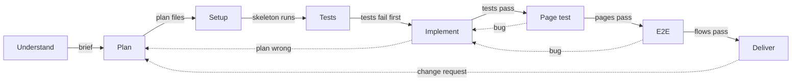
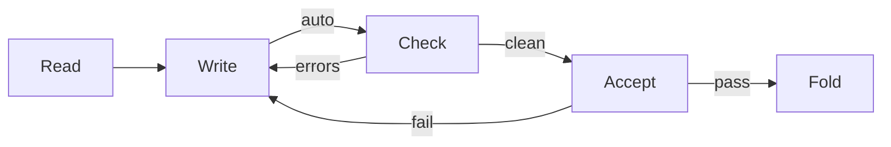
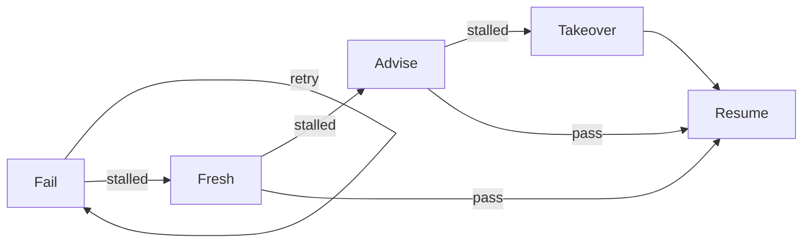

# 0004: SDLC phases and gates

- **Status:** Accepted, 2026-11-12
- **Layer:** flow control
- **Builds on:** [0001](0001-flow-control-hybrid-state-machine.md) (harness owns phases, model owns the loop inside a task), [0003](0003-target-jac-0-36.md), [compiler probe](../research/compiler-probe-0.36.1.md)

## Principle

The harness moves the work from phase to phase. A phase ends only when its **gate** passes. Every gate is a check the harness runs itself; the model saying "done" never passes a gate.

## 1. Phases



| Phase | Model produces | Gate (run by the harness) |
|---|---|---|
| Understand | `brief.md` (section 5) | All required sections filled. Interactive mode: user confirms. |
| Plan | Declaration files (signatures only), file manifest, package list, task list | `jac check` passes on the declarations. Every task names its files, inputs, outputs and acceptance check. Every declared name belongs to exactly one task. |
| Setup | An `install` tool call listing the packages from the plan. The harness copies our template and runs the install. | Server starts. `/static/client.js` returns 200. The template's one client-to-server call returns 200. |
| Tests | Unit tests for every server function and walker, written against the declarations | Tests compile. Each endpoint has at least one test. Every test fails now (no bodies exist yet); a test that already passes is rejected. |
| Implement | Bodies for the declarations, one task at a time | See section 2. Phase ends when the whole test suite passes. |
| Page test | Nothing. The harness opens each page. | Page renders. No error in the server log or console. No request returns 4xx or 5xx. |
| E2E | Fixes only. The steps are the actions in the brief. | The harness runs each action through `jac browse` and finds the expected text. |
| Deliver | Short summary | All earlier gates still pass on a clean start. |

Notes:

- **Plan is written as real Jac declaration files.** The compiler then checks the plan for consistency, and later reports every call site that a changed signature breaks.
- **Setup comes before any feature code.** The stock template does not run on 0.36.1, so we ship our own, with one working round trip already in it.
- **Tests and acceptance steps are written by the small model, before any body.** After their phase they are frozen: the small model cannot edit them during Implement. Only the admin model (Takeover) or a return to Plan can change them.
- **Debugging is not a phase.** It is what happens inside any phase when a gate fails (section 3).
- **A change request re-enters Plan.** See section 8: every change, including a bug fix or a removal, runs the same Plan, Tests, Implement, E2E loop.

## 2. Inside one task



| Step | Who | What happens |
|---|---|---|
| Read | Harness | Builds the task context: the task, its files, the declarations it touches, the map of what exists. |
| Write | Model | Writes or edits only the files the task names. A write to any other file is refused. |
| Check | Harness | Runs after every write, on the edited file only. Returns the first error only. |
| Accept | Harness | Runs the task's acceptance check once Check is clean. |
| Fold | Harness | Replaces the task's turns with one factual summary. The model can unfold it by id. |

What Check covers, beyond `jac check`:

| Check | Why `jac check` alone is not enough |
|---|---|
| Import warnings W1100, W1101, W1102 treated as errors | They are warnings; exit code is 0 |
| Every endpoint the client calls is in the entry file's import list | Missing wiring passes `jac check` and returns 405 at run time |
| Every declaration has a body | A missing body passes and returns `None` |
| Body types match the declaration | Not compared by the compiler |
| No `await` in a non-async function | Not flagged; the generated JavaScript is invalid |

## 3. When a gate keeps failing



| Step | Meaning |
|---|---|
| Fail | The model sees the first error and tries again in the same context. |
| Fresh | The harness discards the task's turns and restarts the task with a factual handover note: what was tried, what the current error is. |
| Advise | The admin model reads the state and writes a hint. The small model still makes the edit. |
| Takeover | The admin model makes the edit itself. It may also fix a wrong test or acceptance step. The fix is logged as recovery training data. |
| Resume | The small model continues from the next step. |

"Stalled" is decided by the harness: the same error after N attempts, the same call repeated, or the task's token budget used up. The values are decision 10.

## 4. Difficulty ladder

The same phases apply at every level; only the size of the plan changes.

| Level | App |
|---|---|
| 1 | One page, one button, one backend call |
| 2 | One page with a form and a table |
| 3 | One page with several components sharing state |
| 4 | Several pages with routing |

## 5. The brief

Written by the model in Understand. Fixed sections, so the harness can check and reuse it.

| Section | Content | Example (level 2 to-do app) |
|---|---|---|
| Goal | One sentence | A to-do list where a user adds tasks and marks them done |
| Pages | Route and purpose | `/`: the list and the add form |
| Data | Things stored, with fields | Task: title (text), done (yes/no) |
| Actions | What a user can do, each as fixed steps | See below |
| Out of scope | What is not built | Login, editing a title |

An action is a list of steps from a closed set: `open`, `fill`, `click`, `expect`.

```
action: add a task
  open   /
  fill   "New task"  with  "Buy milk"
  click  "Add"
  expect "Buy milk"
```

- The quoted labels are a contract: Implement must use exactly these visible labels.
- The harness runs these steps unchanged in E2E. It never has to interpret prose.
- The actions are the app-level acceptance criteria, so they follow the same freeze rule as tests.

## 6. Decided in discussion (2026-11-12)

- Tests and acceptance criteria are written by the small model before implementation.
- The admin model may debug the test suite when a failure persists.
- Packages are installed through a model tool call, so the step appears in trajectories.

- Understand gate in auto mode: the harness checks that the sections are filled; no confirmation.
- Changing a declaration during Implement is decided by the dependency graph. If nothing outside the current task uses the declaration, the change is allowed. If another task's code or tests use it, the work goes back to Plan and the harness reopens the tasks that depend on it.
- Action steps stay at `open`, `fill`, `click`, `expect` for now. More are added when a level needs them.

## 8. Change requests (decided 2026-11-19, not built yet)

A new feature, a bug fix, a behaviour change and a removal are one loop: Plan, then Tests (written first, failing first), then Implement, then the whole suite and every action. Scaffolding is not a phase. Plan declares what is new; if nothing is new it declares nothing.

| Change | Plan | Fails first | Implement |
|---|---|---|---|
| New feature | Declares the new functions and nodes | Its new tests and actions | Bodies |
| Bug fix | Usually declares nothing; adds the task | A test or action that reproduces the bug | Changes bodies |
| Behaviour change | Changes descriptions or signatures | The old tests, rewritten for the new behaviour | Changes code |
| Removal | Names what goes; adds the task | An `expect_not` action; the removed feature's tests and actions are retired | Deletes code |

A removal cannot be done in Plan: Plan's submit runs `jac check` on the whole project, and deleting a declaration the page still uses breaks it. Its proof is `jac check` (a use of a deleted name does not compile) plus the `expect_not` action. `jac code uses <name>` lists the uses in server modules and tests, but on 0.36.1 it misses client uses (`frontend.jac` calls and the `import from server { ... }` lines), so it is not the check.

Gaps to build, in this order, before the next experiment:

1. **An entry for an existing project.** A run takes an earlier run's project and task list plus a new requirement and its actions. Today every run starts from `jac create`, and resume only continues the same task list.
2. **The Tests session runs whenever the request brings new expected behaviour**, not only when a `def:pub` has no body. Today a bug fix declares nothing, so Tests is skipped and nothing fails first. The rule becomes: every new test or action fails now; the old ones still pass, except those the request retires or rewrites.
3. **Test files are frozen per phase, not for good.** The freeze exists so a model cannot pass a task by weakening or deleting its tests. That matters most for training data, where such a trajectory would teach the habit. The rule stays one sentence: `.test.jac` files can change only in a Tests session.
4. **Actions and tests can be retired.** The request lists the old actions and tests it retires. Today actions only accumulate, so a removed feature's actions would run, and fail, forever.
5. **Tasks are cut by feature, not by layer (to be decided by an A/B run on the ten specs: pass rate, replies and tokens per session, wiring errors, page tasks that fix server code).** Every task delivers at least one action, so its server functions, its page part and the wiring between them are built and proven in one session. A data model alone is not a task: nodes are declared in Plan, and the first task whose feature needs one gives it its functions. The Plan card says it in one sentence: a task is one thing the user can see and use, such as a form, a table or a toggle; actions that test the same thing go in one task. This also bounds the task count by the action count. Today Plan may add a task with no action, and on the first four Haiku runs it cut every app into "server functions" and "page".

## 7. Still open

- Stall thresholds (decision 10) and the admin model (decision 10a).
- Task format (decision 5).
