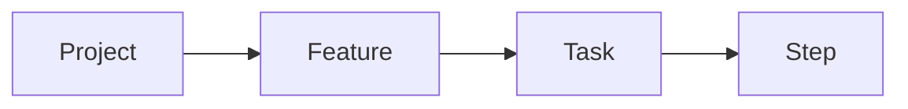
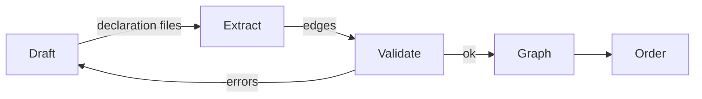
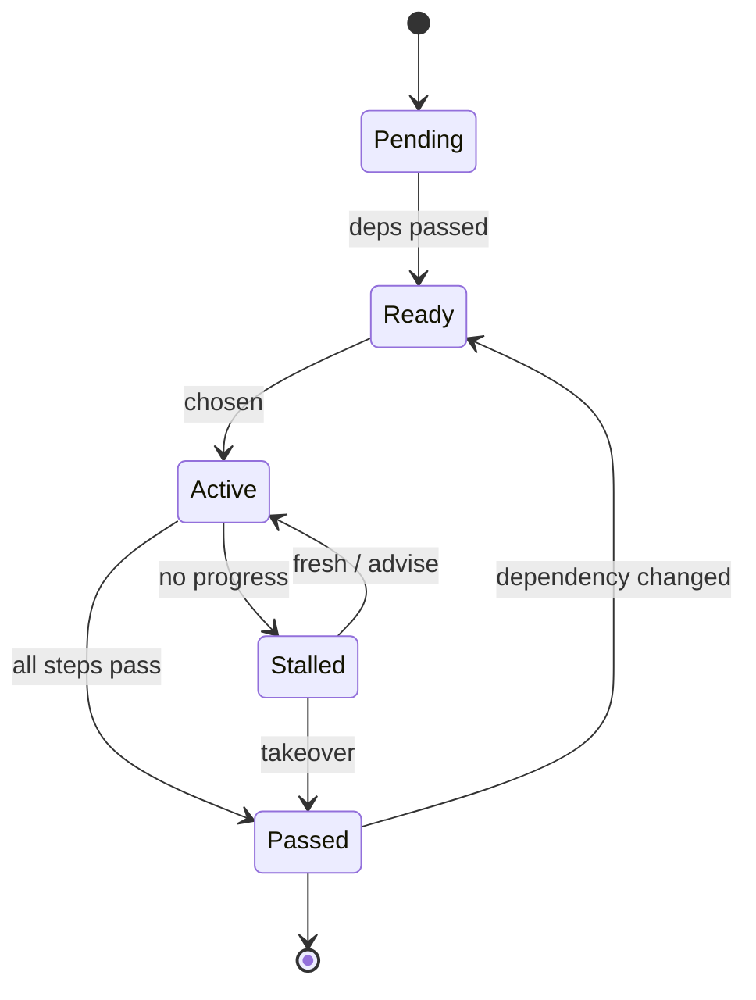

# 0005: Work units and task format

- **Status:** Accepted, 2026-11-12
- **Layer:** flow control, state and recovery
- **Builds on:** [0004](0004-sdlc-phases-and-gates.md)

## Principle

Work is cut by feature, so each finished unit is something a user can do. Anyone, the same model after a restart or the admin model, must be able to pick the work up from the cards and the files on disk, with no memory of earlier turns.

## 1. Four levels

| Level | Is | Example | Done when |
|---|---|---|---|
| Project | The app in the brief | To-do app | Every action in the brief passes in E2E |
| Feature | A group of related actions | Task list | All its tasks pass |
| Task | One action, end to end | "Add a task" | Its unit tests pass and its action from the brief passes in the browser |
| Step | One kind of code inside a task | Server body, wiring, component, page | Check is clean, plus the step's own check (section 3) |

- The first feature is always **Foundation**: the data definitions every other feature uses. Setup has already provided the running skeleton.
- A step is the smallest unit with a gate, and so the smallest unit work can resume from.

## 2. The dependency graph

The model drafts it; a script builds and checks it. The model never writes the graph itself.

| Stage | Who | What happens |
|---|---|---|
| Draft | Model | Writes the declaration files. They contain real `import from M { Name }` lines and typed signatures, so every "uses" relation is ordinary Jac code. |
| Extract | Script | Walks the AST. Edges come from three places: imported names, types used in signatures and fields, components used in JSX. |
| Validate | Script | Every imported name exists (W1100, W1101, W1102 as errors). No cycles. Every endpoint a client file imports is also imported in the entry file. Every declared name is used by something or is an endpoint or a page. |
| Graph | Script | Stored as data: `name -> file`, `name -> names it uses`. Three states per name: built, planned, unknown. |
| Order | Script | Task and step dependencies are computed from the graph, never typed in. |

After each step the script re-extracts from the real code and compares:

| Difference | Response |
|---|---|
| A body uses a planned name that was not in the draft | Edge is added. Allowed if the name's task has passed or is the current one. |
| A body uses a name that is in no file | Error returned to the model: the name does not exist. It must use an existing name or go back to Plan to add one. |
| A drafted edge is not used by the finished body | Recorded, no action |

The model can query the graph at any time through a tool (`map`): what a file exports, who uses a name, whether a name is built, planned or unknown.

## 3. The cards

The model creates tasks with `add_task`, one call per task. The harness renders the list as a readable file for interactive mode.

| Field | Written by | Content |
|---|---|---|
| `id`, `title`, `feature` | Model | `T03`, "Add a task", "Task list" |
| `goal` | Model | One sentence |
| `action` | Model | The action from the brief this task delivers |
| `implements` | Model | Declared names this task gives bodies to |
| `tests` | Model | Unit tests that must pass |
| `steps` | Harness | Derived from `implements`: one step per kind of code, in dependency order |
| `writes` | Harness | Files holding the names in `implements` |
| `depends_on`, `uses` | Harness | From the graph, with the signatures of everything used |
| `status`, `note` | Harness | Status per step; factual handover (attempts, current first error, last test result) |

Step kinds and their checks:

| Step | Writes | Check after `jac check` is clean |
|---|---|---|
| Server | Bodies of the task's server names | The task's unit tests pass |
| Wiring | Entry-file imports | The task's endpoints appear in `/openapi.json` |
| Component | Bodies of the task's components | Props match the declarations |
| Page | The page that shows them | Page renders with no errors; the task's action passes |

Checks on the task list at the Plan gate:

- Every declared name is in exactly one task's `implements`.
- Every action in the brief belongs to exactly one task; every unit test to at least one.
- No cycles between tasks.

## 4. Life of a task

- **Choosing the next task.** The harness lists the Ready tasks; the model picks one. With one Ready task there is no choice. Steps inside a task run in the order the graph gives.
- **Status is never trusted from a stored value.** On resume the harness re-runs every step's check and sets the status from the result.

## 5. Size and context

- **Context resets at each task.** Inside a task, each finished step is folded to a summary. A new task starts from the cards and the graph.
- The limit is the context window: 262,144 tokens. No smaller cap is set by guess.
- The harness records tokens used per step, per task and per feature, with the outcome (passed, stalled, escalated). The reset point and any size limit are revisited when these measurements show where success drops.
- Known risk, to be measured and not assumed: training samples so far reach 64k tokens, so behaviour beyond that is untested.

## 6. The Tests session

The Tests phase of 0004 is one session after Plan, before any body is written. It runs only when some `def:pub` server function has no body and no test calls it yet, so a resumed run skips it.

| | Tests session |
|---|---|
| Card | The requirement, the functions to test, where tests go (`<module>.test.jac`, an annex that sees the module without imports) |
| Tools | list, read, search, guide, guide_search, write, edit, test, submit |
| Done when | `jac check` clean; descriptions; every test is in a `.test.jac` file; every function to test is called in a test; they still have no bodies; every test fails now |

After the session:

- **Each test belongs to one task:** the first task, in plan order, after which every function the test calls has a body. Its card lists them under `Done when` ("these tests pass"), and the finished tasks' tests run again at each later submit.
- **`.test.jac` files are frozen.** A write or edit to one in a task session is refused. Only the admin may fix a test, and only a wrong one.
- Tests run on a fresh copy of the project, so every run starts with no stored data. The run's result line reports the whole suite (`tests=passed/total`).
