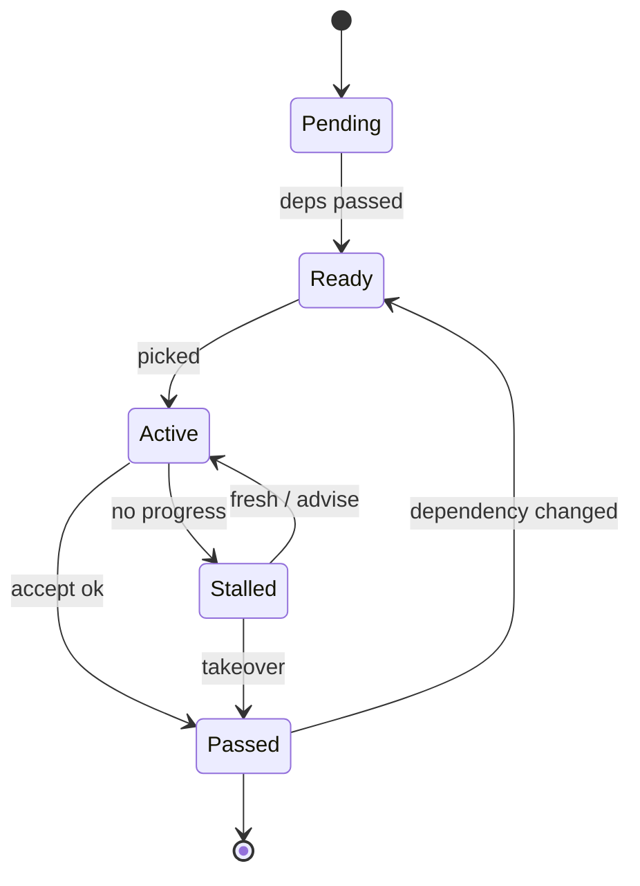
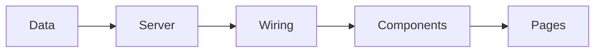

# 0005: Task format

- **Status:** Proposed, 2026-11-12. Not yet accepted.
- **Layer:** flow control, state and recovery
- **Builds on:** [0004](0004-sdlc-phases-and-gates.md)

## Principle

A task is the amount of work the small model does in one context. Anyone, the same model after a restart or the admin model, must be able to pick a task up from its card and the files on disk, with no memory of earlier turns.

## 1. The task card

| Field | Written by | Content |
|---|---|---|
| `id`, `title` | Model | `T03`, "Task endpoints" |
| `goal` | Model | One sentence |
| `writes` | Model | Files this task may create or edit. No other file can be written. |
| `implements` | Model | Declared names this task gives bodies to |
| `accept` | Model | Unit test names, or action names from the brief |
| `depends_on` | Harness | Tasks whose declarations this one uses, from the dependency graph |
| `reads` | Harness | Signatures of everything the task uses, taken from the declaration files |
| `status` | Harness | See section 2 |
| `note` | Harness | Factual handover: attempts so far, current first error, last test result |

- The model creates tasks with an `add_task` tool call in Plan, one call per task. It does not write a task file by hand.
- The model fills only what needs judgement. Everything that can be derived from the code is derived, so it cannot be wrong or stale.

Example, as the model sees it at the start of the task:

```
T03  Task endpoints
goal:        Store tasks and return the list.
writes:      tasks.impl.jac
implements:  AddTask, ListTasks, ToggleTask
accept:      test_add_task, test_list_tasks, test_toggle_task
uses:        node Task { has title: str; has done: bool = False; }
status:      active (attempt 1)
```

## 2. Life of a task



| Status | Meaning |
|---|---|
| Pending | A task it depends on has not passed |
| Ready | Can start. The harness picks the next ready task; the model does not choose. |
| Active | The model is working on it |
| Stalled | The stall rule fired (decision 10); the ladder in 0004 section 3 applies |
| Passed | Check is clean and every item in `accept` passes |

**Status is never trusted from a stored value.** On resume the harness re-runs Check and `accept` for every task and sets the status from the result. A crash, a manual edit or a wrong claim cannot leave the task list out of step with the code.

## 3. Cutting the plan into tasks



| Kind | One task is | Accepted by |
|---|---|---|
| Data | The node and edge definitions | `jac check` |
| Server | The bodies of one server module | Its unit tests |
| Wiring | Entry-file imports for every endpoint | Each endpoint appears in `/openapi.json` |
| Components | One client component | Check clean; its props match the declaration |
| Pages | One page | Page renders with no errors; its actions from the brief pass |

Rules the harness enforces on the task list at the Plan gate:

- Every declared name is in exactly one task's `implements`.
- Every file is in exactly one task's `writes`.
- Every unit test and every action is in some task's `accept`.
- No dependency cycles.
- Size limit: at most 5 names in `implements` and 2 files in `writes`. A larger task is rejected and must be split.

The Tests phase uses the same card: one task per server module, `writes` is the test file, accepted when the tests compile and fail.

## 4. Open points

1. **Slicing.** This draft cuts by layer (all server, then all client). The alternative is by feature: one task builds one action end to end (endpoint, component, wiring). By layer is simpler and each task has one kind of code. By feature gets a working button earlier and makes each task's acceptance a real user action.
2. **Size limit.** 5 names and 2 files is a guess. It should come from the context budget (decision 3).
3. **Order.** The harness picks the next ready task. Should the model have any say?
4. **`add_task` versus a file.** A tool call per task uses the format the model is already reliable at. A file is easier for a person to read and edit in interactive mode. The harness can render the file from the calls.
