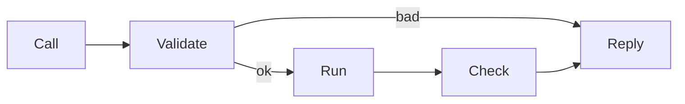

# 0006: Tool set

- **Status:** Accepted, 2026-11-12
- **Layer:** tool set
- **Builds on:** [0004](0004-sdlc-phases-and-gates.md), [0005](0005-task-format.md), [model status](../research/model-status-2026-11-11.md)

## Principles

1. **Few tools, and only the ones valid now.** The model sees the tools of its current phase, not the whole set. (Measured: of 27 tools offered, 11 were used.)
2. **No general shell.** Every command the model needs is a named tool with typed parameters.
3. **Anything that must always happen is not a tool.** The harness does it. The model cannot forget it or skip it.
4. **Every result says what is true now and, on failure, what to do next.** Output is bounded; a cut is marked and says how to see the rest.

## 1. What happens on a tool call



| Stage | What happens |
|---|---|
| Validate | Tool is allowed in this phase. Parameters parse. Path is inside the task's `writes`. A call identical to a recent failed one is refused with the earlier result. |
| Run | The tool does its work. |
| Check | After any change to a file: the checks of 0004 section 2 run on that file. |
| Reply | Result, then the first check error if any, then the step's status. |

## 2. The tools

18 tools in five groups.

| Group | Tool | Parameters | Returns |
|---|---|---|---|
| Files | `read` | `path`, `from?`, `to?` | Lines with numbers |
| | `write` | `path`, `content` | Check result |
| | `edit` | `path`, `old`, `new` | Check result |
| | `search` | `text`, `path?` | Matching lines with file and line number |
| Knowledge | `lookup` | `name` | What the name is (see below), its signature or meaning, where it is defined, who uses it |
| | `map` | `path?` | What a file defines and imports; with no path, the list of project files |
| | `guide` | `topic` | The `jac guide` page of the installed version |
| | `unfold` | `id` | The full turns behind a folded summary |
| Plan | `add_task` | Card fields of 0005 | The task list checks that now fail |
| | `drop_task` | `id` | Same |
| | `install` | `packages`, `kind` (python, npm, shadcn) | Installed versions, or the error |
| Run | `test` | `names?` | Pass or fail per test; the first failure in full |
| | `browse` | `steps` (open, fill, click, expect) | Per step: ok or failed; page text snapshot; errors from the server log and console |
| Control | `pick` | `task` | The task card |
| | `submit` | none | Runs the current gate; lists what fails |
| | `replan` | `reason` | Returns the work to Plan |
| | `ask` | `question` | The user's answer. Interactive mode only. |
| | `stuck` | `reason` | Starts the escalation ladder of 0004 section 3. Allowed only after at least one failed check in the current step. |

Notes on the two editing tools:

- `write` replaces a whole file. It is the normal way to create a file and the fallback when edits keep failing.
- `edit` replaces one exact piece of text. Matching ignores differences in indentation and trailing spaces.
- An `edit` that fails says why and helps: `old` not found returns the closest text in the file; `old` found more than once returns the line numbers; `old` equal to `new` is refused. (Measured on v1.35: 75 identical old/new, 66 not found.)

### `lookup`: what a name is

One answer per name, from a fixed set of kinds:

| Kind | Source | Example answer |
|---|---|---|
| Keyword | Keyword table of the installed Jac version | `node`: keyword. Declares a graph node type. Not usable as a name; write `` `node `` to escape. |
| Built-in | Compiler | `root`: built-in reference to the current user's root node. Cannot be assigned. |
| Project name, built | Dependency graph | `AddTask`: walker in `tasks.jac`. `has title: str`. Used by `pages/index.jac`. |
| Project name, planned | Dependency graph | `ToggleTask`: walker declared in `tasks.jac`, no body yet (task T04). |
| File or module | Dependency graph | `tasks`: module `tasks.jac`. Defines Task, AddTask, ListTasks. |
| Package export | Installed packages | `useState`: exported by `react`. |
| Unknown | None of the above | `DeleteTask`: not defined anywhere. Closest names: `ToggleTask`, `AddTask`. |

For a project name the answer is a hover card, like the one an IDE shows:

```
walker:pub AddTask            tasks.jac    planned (T03)
  "Create a task under root."
  has title: str
  has level: Level = Level.LOW
  can make with Root entry

uses:     enum Level { LOW = 1, HIGH = 2 }
          node Task { has title: str; has done: bool = False; }
used by:  pages/index.jac
```

| Part | Content |
|---|---|
| Header | Kind, access tag, name, file, state |
| Body | Docstring; every field with type and default; every method and ability with its full signature |
| `uses` | The types it refers to, each expanded one level |
| `used by` | Files that use it |

Probe on 0.36.1: `jac code symbol NAME --text` and `jac code slice NAME` give most of this already (fields with types, referenced types, use sites), but drop field defaults, method parameters, ability entry clauses and enum members. The card is therefore rendered by our own AST walk ([compiler probe](../research/compiler-probe-0.36.1.md) section 2), which has them.

### Keyword note on errors

When an error sits on a token that is a Jac keyword or built-in, the harness adds the `lookup` answer for that word to the error result. The model can then judge whether it misused the word or meant a name.

Measured on 0.36.1, the compiler's own messages are uneven, which is why the note is needed:

| Code | Compiler says |
|---|---|
| `def f(report: int)` | Clear: E0013, names the keyword and the backtick escape |
| `has root: int` | Clear: E0024, built-in reference |
| `node = "a";` | Unclear: "Expected identifier, got '='". Does not say `node` is a keyword. |
| `entry = 1;`, `here = 3;`, `def visit()`, `has test`, `has props` | Accepted, no message |

The note is added only on an error, not on every use of a keyword. The keyword table is data read for the installed version (decision 8).

### `guide` and loading documentation

There is no separate skill-loading tool. The topics of `jac guide` are the skills: 40 topics on 0.36.1, between about 900 and 3,700 words each. `guide(topic)` loads one.

The model rarely asks for documentation by itself (3 of 12 tasks), so the tool is not the main path. The harness puts the relevant topic, or the relevant part of it, into the context at the start of a step, chosen by the kind of step. Which topic for which step is decision 8.

### Line numbers

The model never counts lines.

- `read` prints the number in front of every line.
- `edit` finds its place by matching text, not by number.
- An error result includes the source lines around the error, with the reported line marked and two lines before it (the compiler often reports one line late). The model reads the code, not the number.
- Folded lines carry no line numbers; they go stale when the file changes.
- Known risk: the model copies the number prefix from `read` output into `edit` or `write`. The prefix uses a separator that is not valid Jac (`14│ `), `edit` strips it from `old` and `new` before matching, and `write` refuses content whose lines all start with it.

## 3. Done by the harness, not by a tool

| Action | When |
|---|---|
| `jac check` and the extra checks | After every `write` and `edit` |
| Rebuild the dependency graph | After every `write` and `edit` |
| Start and restart the dev server; wait for `/static/client.js` | Before `browse`; after a file change |
| Fold a finished step | When the step's check passes |
| Step and task status | After every check |
| Stall detection and escalation | Continuously |

## 4. Tools per phase

| Tool | Understand | Plan | Setup | Tests | Implement | Page test, E2E |
|---|---|---|---|---|---|---|
| `read`, `search` | ✓ | ✓ | ✓ | ✓ | ✓ | ✓ |
| `write`, `edit` | brief only | declarations only | | test files only | task's files only | task's files only |
| `lookup`, `map`, `guide` | | ✓ | | ✓ | ✓ | ✓ |
| `unfold` | | ✓ | | ✓ | ✓ | ✓ |
| `add_task`, `drop_task` | | ✓ | | | | |
| `install` | | | ✓ | | ✓ | |
| `test` | | | | ✓ | ✓ | ✓ |
| `browse` | | | | | page steps | ✓ |
| `pick` | | | | ✓ | ✓ | |
| `submit` | ✓ | ✓ | ✓ | ✓ | ✓ | ✓ |
| `replan` | | | | ✓ | ✓ | ✓ |
| `ask` | ✓ | ✓ | | | | |
| `stuck` | | ✓ | | ✓ | ✓ | ✓ |

The largest set the model sees at once is 15 (Implement).

## 5. The admin model

The admin model is not limited to this set. It also gets a shell, and may edit tests and acceptance steps (0004). Its calls are logged in the same format so they can become training data.

## 6. Decided in discussion (2026-11-12)

- `search` stays. The brief is written with `write` and parsed by the harness. `install` is allowed in Implement. A call identical to a recent failed one is refused.
- The model may ask for help with `stuck`. Early on, generous admin intervention is wanted because it yields better trajectories.
- How help is used as training data (details belong to decision 12):

| Part of the trajectory | In training |
|---|---|
| The `stuck` call | In context only; no loss. The model is not trained to ask. |
| The failed attempts before it | In context only; no loss |
| The admin's fix | The training target, at the state the small model actually reached |
| An admin hint (Advise) | Removed from context, or rewritten as the model's own reasoning. No hint exists at deployment. |

- The admin's fix must be expressed as small-model tool calls (`write`, `edit`). A fix made through the admin's shell is replayed in that form before it is used for training.
