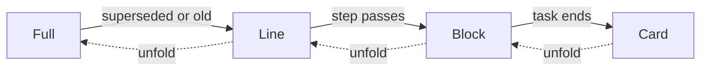
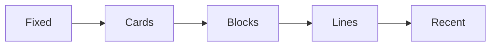

# 0007: Fold and unfold

- **Status:** Proposed, 2026-11-12. Not yet accepted.
- **Layer:** context assembly
- **Builds on:** [0005](0005-task-format.md) (context resets per task; steps fold when they pass), [0006](0006-tool-set.md) (`unfold`)

## Principles

1. **Nothing is ever deleted.** Every message is stored in full with a stable id. Folding changes only what the model is shown.
2. **The harness folds; the model unfolds.** No language model writes a summary, at any level. Fold text is filled into fixed templates from the structured result of each tool (section 3). The only model-written text in a fold is the task's `goal`, which was written in Plan before the work started.
3. **No compaction.** There is no step that rewrites the whole history.

Why the harness and not the model:

| Evidence | Source |
|---|---|
| Untrained model-driven folding scored below a plain agent | [context-folding-foldgrpo](../knowledge/context-management/context-folding-foldgrpo.md) |
| The weakest model tested failed at managing its own memory | [memgpt](../knowledge/context-management/memgpt.md) |
| Hiding old tool results by rule matched LLM summaries on solve rate | [jetbrains-complexity-trap](../knowledge/context-management/jetbrains-complexity-trap.md) |
| A failed call left in context is copied by small models | [feedback-that-backfires](../knowledge/stuck-in-a-loop/feedback-that-backfires.md) |

This departs from the method in [context-folding-for-coding-agent-harnesses](../knowledge/context-management/context-folding-for-coding-agent-harnesses.md), where the model chooses what to fold and writes the summary. We keep its other invariants: stable ids, stored sources, recoverable lineage, protected content.

## 1. Three levels



| Level | Covers | Shown to the model as | Example |
|---|---|---|---|
| Full | One tool call and its result | The original text | |
| Line | One tool call and its result | One line with an id | `[m12] edit tasks.impl.jac -> check failed: E1053 line 14` |
| Block | One finished step | A few lines with an id | `[s3] Server step passed. Wrote tasks.impl.jac. Implemented AddTask, ListTasks. 3 attempts. Errors met: E1053 (wrong argument type).` |
| Card | One finished task | Its id, title, status and the `goal` sentence from the task card. All implementation detail is hidden. | `[T03] passed. Add a task: store a new task and show it in the list.` |

## 2. When a turn goes from Full to Line

Every tool call ends with a status set by the harness: `ok`, `failed` or `refused`.

| Status | Set when |
|---|---|
| `ok` | The tool ran and, for a file change, the checks are clean; for `test` and `browse`, everything passed |
| `failed` | The tool ran but a check, a test or an `expect` failed; or the tool itself returned an error |
| `refused` | Validation stopped the call (tool not allowed, path outside the task, repeat of a failed call) |

Folding rules:

| Rule | Reason |
|---|---|
| A `failed` or `refused` turn is folded as soon as the model makes its next call. Only the newest failure is ever shown in full. | The model needs the current error to fix it. Older errors take space and invite copying. The line still says what was called and that it failed. |
| A `read` or `write` of a file that has since been read or written again is folded | Only the newest view of a file is true |
| An `ok` result of `guide`, `map`, `search`, `test` or `browse` older than the last *K* turns is folded | Old output is rarely needed again |
| The model's reasoning is removed from every turn once its tool call has been made | It is stored for the log, not shown again. To verify: this should match how the chat template used in training treats earlier reasoning. |

- *K* is not guessed. The harness starts with all `ok` turns Full inside a step and we lower *K* from measurement (tokens per step against pass rate). The published best values differ by harness (10 and 58 in the two measured in the JetBrains study), so no outside number transfers.
- Reasoning that runs away is a separate problem, handled by a budget on generation (decisions 10 and 15), not by folding.

## 3. How a line is generated

No text is composed. Each tool returns two things: the full result for the model, and a record with fixed fields. One function renders any record as a line.

```
[id] <tool> <target> -> <status>[: <code> <where>]
```

| Field | Filled from |
|---|---|
| `id` | Message id assigned when the turn is stored |
| `tool` | Tool name |
| `target` | The tool's main parameter (table below) |
| `status` | `ok`, `failed`, `refused` |
| `code` | First error code from the compiler, or a fixed reason word from the harness |
| `where` | File and line of that first error, or the failing test or step |

| Tool | `target` | `code` and `where` on failure | Example |
|---|---|---|---|
| `read` | path and line range | `not-found` | `[m4] read tasks.jac 1-40 -> ok` |
| `write` | path | first check error | `[m9] write tasks.impl.jac -> failed: E1053 tasks.impl.jac:14` |
| `edit` | path and the line range changed | first check error, or `old-not-found`, `old-not-unique`, `no-change` | `[m12] edit tasks.impl.jac 10-16 -> failed: old-not-found` |
| `search` | the text | none | `[m5] search "Add" -> ok (3 hits)` |
| `map`, `guide` | name or topic | `unknown` | `[m6] map AddTask -> ok (planned)` |
| `install` | package names | `install-error` | `[m2] install lucide-react -> ok` |
| `test` | test names, or `all` | first failing test | `[m15] test all -> failed: test_toggle_task (2 of 3 pass)` |
| `browse` | action name | first failing step | `[m20] browse "add a task" -> failed: expect "Buy milk"` |
| `add_task`, `drop_task`, `pick` | task id | failing plan check | `[m3] add_task T03 -> ok` |
| `submit` | step or phase | first failing gate item | `[m22] submit Server -> ok` |
| `unfold` | the id | `unknown-id` | `[m18] unfold m9 -> ok` |

A block is rendered the same way from the step's records: files written, names implemented, number of `failed` turns, the distinct error codes met, final status.

## 4. What is never folded

| Item | Where it sits |
|---|---|
| System prompt and the tools of the phase | Top |
| The current task card and step | Top |
| Signatures the task uses (from the graph) | Top |
| The newest content of each file in the task's `writes` | In place, at its latest read or write |
| The current first error | Last tool result |

## 5. Layout of one request



| Part | Content | Changes |
|---|---|---|
| Fixed | System prompt, tools | Per phase |
| Cards | Current task card; one line per finished task | Per task |
| Blocks | Finished steps of this task | Per step |
| Lines | Folded turns of the current step | Grows at its end |
| Recent | Full turns | Every turn |

The order is oldest and most stable first. A fold only ever changes text near the end, so the server's prompt cache stays valid for everything before it. This matters on a local server, where re-reading a long prompt costs seconds.

## 6. Unfold

- `unfold(id)` takes any id shown in a line, block or card.
- The content comes back as an ordinary tool result at the end of the context. History is not re-expanded in place, so the cache is kept.
- One level at a time: a card gives its blocks, a block gives its lines, a line gives the full turn.
- Output is bounded. A long turn is returned in part, with the range to ask for next.
- The unfolded result is itself folded later by the rules of section 2.

Risk: the model may never call `unfold`. It rarely loaded documentation on its own (3 of 12 tasks), and the source article saw no spontaneous recovery. Two answers: the lines and blocks carry the facts most often needed, so unfold is rarely required; and the training trajectories must contain correct uses of `unfold`.

## 7. Measured from the start

Tokens per request and per step; number of folds; `unfold` calls and whether the next action used the result; files re-read after their turn was folded (a sign the fold hid something needed).

## 8. Decided in discussion (2026-11-12)

- No model-written summaries or notes. The task `goal` is the card text.
- A finished task shows only that it is done and what it was for.
- Failures are folded; the model sees the call and its status, and opens the detail only with `unfold`. The newest failure stays in full.
- Reasoning is not kept in history.

## 9. Training view

Training trajectories are rendered with the same rules, so the model learns in the context it will see at run time: `ok` calls in full, earlier failures as one line.
