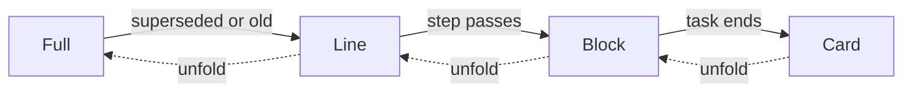
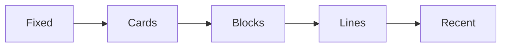

# 0007: Fold and unfold

- **Status:** Proposed, 2026-11-12. Not yet accepted.
- **Layer:** context assembly
- **Builds on:** [0005](0005-task-format.md) (context resets per task; steps fold when they pass), [0006](0006-tool-set.md) (`unfold`)

## Principles

1. **Nothing is ever deleted.** Every message is stored in full with a stable id. Folding changes only what the model is shown.
2. **The harness folds; the model unfolds.** Fold text is built by the harness from facts (tool, file, check result). The model does not write summaries.
3. **No compaction.** There is no step that rewrites the whole history.

Why the harness and not the model:

| Evidence | Source |
|---|---|
| Untrained model-driven folding scored below a plain agent | [context-folding-foldgrpo](../knowledge/context-management/context-folding-foldgrpo.md) |
| The weakest model tested failed at managing its own memory | [memgpt](../knowledge/context-management/memgpt.md) |
| Hiding old tool results by rule matched LLM summaries on solve rate | [jetbrains-complexity-trap](../knowledge/context-management/jetbrains-complexity-trap.md) |
| A failed call left in context is copied by small models | [feedback-that-backfires](../knowledge/stuck-in-a-loop/feedback-that-backfires.md) |

This departs from the method in [context-folding-for-coding-agent-harnesses](../knowledge/context-management/context-folding-for-coding-agent-harnesses.md), where the model chooses what to fold and writes the summary. We keep its other invariants: stable ids, stored sources, recoverable lineage, protected content.

## 1. Three levels

| Level | Covers | Shown to the model as | Example |
|---|---|---|---|
| Full | One tool call and its result | The original text | |
| Line | One tool call and its result | One line with an id | `[m12] edit tasks.impl.jac -> check failed: E1053 line 14` |
| Block | One finished step | A few lines with an id | `[s3] Server step passed. Wrote tasks.impl.jac. Implemented AddTask, ListTasks. 3 attempts. Errors met: E1053 (wrong argument type).` |
| Card | One finished task | One line with an id | `[T03] Add a task: passed` |

## 2. When a turn goes from Full to Line

A turn is folded to a line as soon as one of these is true:

| Rule | Reason |
|---|---|
| It is a failed call and a later call has been made | The model should know it failed, not see text it can copy |
| It is a `read` or `write` of a file that has since been read or written again | Only the newest view of a file is true |
| It is a `guide`, `map`, `search`, `test` or `browse` result older than the last *K* turns | Old output is rarely needed again |

- *K* is not guessed. The harness starts with all turns Full inside a step and we lower *K* from measurement (tokens per step against pass rate). The published best values differ by harness (10 and 58 in the two measured in the JetBrains study), so no outside number transfers.
- The model's own reasoning is dropped from a folded turn. It is still stored.

## 3. What is never folded

| Item | Where it sits |
|---|---|
| System prompt and the tools of the phase | Top |
| The current task card and step | Top |
| Signatures the task uses (from the graph) | Top |
| The newest content of each file in the task's `writes` | In place, at its latest read or write |
| The current first error | Last tool result |

## 4. Layout of one request

| Part | Content | Changes |
|---|---|---|
| Fixed | System prompt, tools | Per phase |
| Cards | Current task card; one line per finished task | Per task |
| Blocks | Finished steps of this task | Per step |
| Lines | Folded turns of the current step | Grows at its end |
| Recent | Full turns | Every turn |

The order is oldest and most stable first. A fold only ever changes text near the end, so the server's prompt cache stays valid for everything before it. This matters on a local server, where re-reading a long prompt costs seconds.

## 5. Unfold

- `unfold(id)` takes any id shown in a line, block or card.
- The content comes back as an ordinary tool result at the end of the context. History is not re-expanded in place, so the cache is kept.
- One level at a time: a card gives its blocks, a block gives its lines, a line gives the full turn.
- Output is bounded. A long turn is returned in part, with the range to ask for next.
- The unfolded result is itself folded later by the rules of section 2.

Risk: the model may never call `unfold`. It rarely loaded documentation on its own (3 of 12 tasks), and the source article saw no spontaneous recovery. Two answers: the lines and blocks carry the facts most often needed, so unfold is rarely required; and the training trajectories must contain correct uses of `unfold`.

## 6. Measured from the start

Tokens per request and per step; number of folds; `unfold` calls and whether the next action used the result; files re-read after their turn was folded (a sign the fold hid something needed).

## 7. Open points

1. **Model note.** Should the model be able to add one line of its own to a block ("why I chose this"), or stay with facts only?
2. **Reasoning in recent turns.** Keep the model's reasoning text in the Full turns, or drop it from history once the tool call is made? It can be long (median 197 characters, but runaways up to 171,797).
3. **Failed attempts.** Folded to a line immediately (this draft), or kept Full until the error is fixed?
