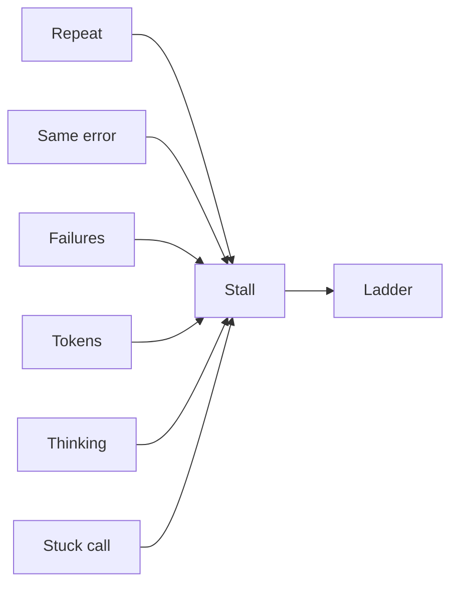

# 0010: Stall detection

- **Status:** Accepted, 2026-11-12
- **Layer:** flow control
- **Builds on:** [0004](0004-sdlc-phases-and-gates.md) section 3 (the ladder), [0006](0006-tool-set.md), [0012](0012-run-log-format.md)

## Principle

The harness decides that the model is stalled, from the log. A stall moves the step one rung up the ladder of 0004: Fresh, Advise, Takeover. All limits are settings, recorded in `meta.json` of every run, and are revised from measurement.

## 1. Signals

| Signal | Rule | Starting value |
|---|---|---|
| Same error | The first error (code and message) is unchanged after this many consecutive failed calls | 3 |
| Failures | Failed or refused calls in the step, in total | 5 |
| Repeat | A call identical to an earlier failed one. Refused at once (0006); each refusal counts as a failure. | |
| Step tokens | Context tokens used by the step | 32,000 |
| Task tokens | Context tokens of the whole task | 64,000 |
| Thinking | Tokens of reasoning in one reply. Generation is cut at the limit; the cut reply counts as a failure. | 2,048 |
| Stuck call | The model calls `stuck` | Immediate |

Counters reset when the step passes, and when the ladder moves (a Fresh restart starts from zero).

## 2. Where the starting values come from

| Value | Basis |
|---|---|
| 5 failures | Chosen in discussion. |
| 3 for the same error | Existing trajectories of large models in the jacBuilder harness (870 trajectories, 612 runs of consecutive failed tool calls that ended in success): 87% were fixed after 1 failure, 97% within 2, 99% within 3. A fix that has not come by the third attempt almost never came. This is large-model data; the small model has almost no successful fixes to measure (10 of 2,082 replies). |
| 32,000 tokens per step | Chosen in discussion. For scale: in the same data a failure-to-fix episode took a median of about 180 tokens and at most about 9,000. A task has up to four steps in one context, so four full steps would reach 128,000, twice the longest training sample (64,000). The step limit alone does not keep a task inside the trained range. |

| 64,000 tokens per task | The longest sample the model has been trained on. Raised as training samples get longer. 262,144 remains the hard limit. |
| 2,048 thinking tokens | Median reasoning is 197 characters; the longest seen is 171,797. To confirm with the training side. |

## 3. Decided in discussion (2026-11-12)

- Limits are 3 (same error) and 5 (failures) from the first data collection on. No stricter early setting.
- Task limit of 64,000 tokens and thinking limit of 2,048 tokens are added.
