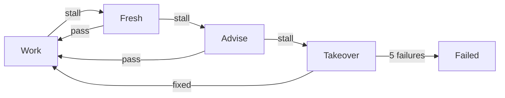

# 0010a: Admin escalation

- **Status:** Accepted, 2026-11-12
- **Layer:** flow control
- **Builds on:** [0004](0004-sdlc-phases-and-gates.md) section 3, [0006](0006-tool-set.md) section 6, [0010](0010-stall-detection.md)

## The ladder

| Rung | Who acts | What happens | Ends when |
|---|---|---|---|
| Work | Small model | Normal loop | Step passes, or a stall signal of 0010 fires |
| Fresh | Small model | New session on the same step. Context: task card, current files, current first error, earlier attempts as folded lines. | Step passes, or stall |
| Advise | Admin writes, small model acts | The admin writes one hint: where the problem is and what to look at. No code. | Step passes, or stall |
| Takeover | Admin | The admin edits until the current step's check passes, then stops. | Step passes, or the admin has 5 failures |
| Failed | Harness | The task is marked failed. The run continues with tasks that do not depend on it. | |

- Each rung is tried once. The stall counters start from zero on every rung.
- The admin is a large model called through an API. The provider is a setting.
- The admin sees the same context the small model had, may unfold anything, and has a shell.
- After a takeover the small model continues from the next step.

## Settings and limits

| Setting | Value |
|---|---|
| Admin failures before the task is marked failed | 5 |
| Admin calls per run | No limit at first. The count is logged per run; a limit is set after the first batch of runs. |

## Training data

Rules are in 0006 section 6 and 0012 section 4: the admin's fix becomes an ordinary assistant turn, replayed as small-model tool calls; hints and `stuck` calls are removed from every rendered view.
