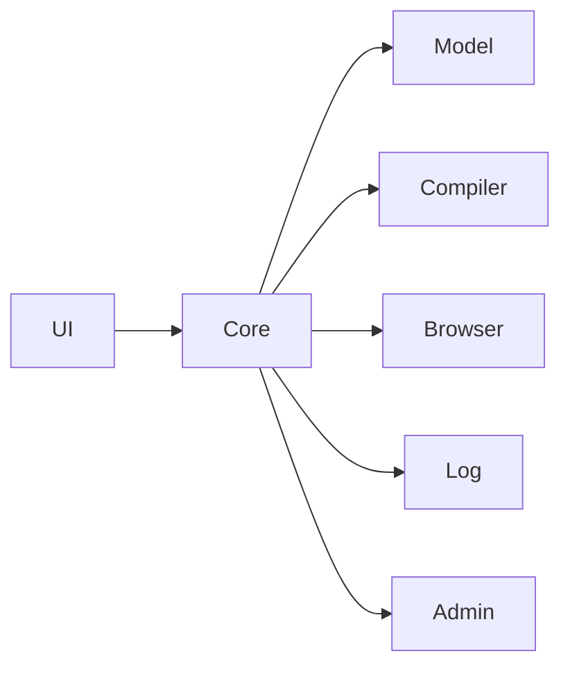

# 0011: Build from scratch, in Jac

- **Status:** Proposed, 2026-11-12. Not yet accepted.
- **Layer:** all
- **Builds on:** [0001](0001-flow-control-hybrid-state-machine.md) to [0007](0007-fold-and-unfold.md), [pi research](../research/pi-harness.md), [spike](../../prototypes/jac-spike/)

## Options

| Option | Meaning |
|---|---|
| A. pi | Write Jach as extensions on pi 1.0.4 (TypeScript) |
| B. Scratch, Python | Own loop in Python |
| C. Scratch, Jac | Own loop in Jac; work tree as a graph, sessions as walkers |

## Recommendation

**C.** The parts pi gives for free are parts we do not need or have decided to do differently; the parts we need most are the ones pi has no concept of. Between B and C, Jac gives the compiler in-process and the graph model, at the cost of language churn.

## 1. Requirements against options

| # | Requirement (decision) | A. pi | B. Python | C. Jac |
|---|---|---|---|---|
| 1 | Phase state machine with gates (0004) | No core concept; spread over event callbacks | Direct | Direct; walkers over the work tree |
| 2 | Different tools per phase (0006) | `setActiveTools`, but pi then inserts a system message mid-conversation, a shape the model never saw | Direct | Direct |
| 3 | Exact control of the prompt: fold layout, empty think blocks, stable prefix (0007) | Partly: `context` and `before_provider_request` can replace content, working against pi's own assembly | Direct | Direct |
| 4 | Survive a cut-off or malformed tool call | No repair or retry | Own parser | Own parser |
| 5 | Check, AST and graph after every write (0004, 0005) | Subprocess to a Jac worker | Subprocess to a Jac worker (jac 0.36.1 ships its own runtime; `jaclang` is not importable from system Python) | In-process |
| 6 | Trajectory log in our format, with loss masks (0006) | pi's own session tree; needs a converter | Direct | Direct |
| 7 | Same renderer for run time and training (0007) | Must re-implement pi's serialisation for training | Shared code | Shared code |
| 8 | Work tree that persists (0005) | Write it | Write it | Nodes and edges; persistence built in |
| 9 | Interactive UI (0002) | **Terminal UI for free** | Build | Build; a web UI in the same language |
| 10 | Headless batch (0002) | JSON and RPC modes exist | Direct | Direct |
| 11 | Upkeep | Large, fast-moving, outside PRs closed | Stable language | Jac changes between versions |

What pi would give us and we would lose: the terminal UI, provider abstraction, session branching, compaction. We need only the first; compaction is ruled out by 0007.

## 2. What the spike showed

A 90-line Jac program: root -> Project -> Feature -> Task -> Step; one walker spawned on the task; a real call to `llama-server` with JacLLM v1.35.

| Question | Result |
|---|---|
| Does "one walker = one session" work? | Yes. The walker holds the messages; abilities fire per node type (Task opens the context, Step runs the loop); each turn is attached to its step as a node. |
| Can we see the exact prompt? | Yes. `/apply-template` returns the rendered text, including the empty think block. |
| Speed | One tool-call turn in 1.9 s (323 tokens in, 237 out) |
| Cut-off output | With the output limit reached mid-call, the tool arguments were invalid JSON. Sending that turn back through the chat endpoint returned HTTP 500. The harness must parse model output itself and must never send a broken call back. |
| Model behaviour | Asked for one node definition, it also wrote an edge, a walker and an entry block. Scope has to be enforced by the checks, not requested in the prompt. |
| Jac friction | One syntax form I used had been removed in 0.36 (`(?:Type)` is now `[?:Type]`). The compiler's message gave the fix. |

## 3. Shape of the build

| Part | Role | Note |
|---|---|---|
| Core | Work tree, phases, gates, sessions, tools, fold | Jac. root -> Project -> Feature -> Task -> Step -> Turn. One walker per session; the admin is another walker type spawned on the same task. |
| Model | Talks to `llama-server` | Raw completion with our own rendering and our own tool-call parser. No `by llm` here. |
| Compiler | Check, AST, dependency graph, keyword table | Behind one module with a JSON-shaped interface. In-process now; can become a separate process when the target Jac version moves. |
| Browser | `jac browse`, dev server | Subprocess |
| Log | Append-only JSONL, one line per event | The source of truth. The graph can be rebuilt from it. Walkers with `report` produce the model context, the training samples and the statistics. |
| Admin | The large model | `by llm` is acceptable here |
| UI | Headless first; then a simple interactive front end | The core has no UI code (0002) |

## 4. Risks

| Risk | Answer |
|---|---|
| Jac changes break the harness itself | Harness pinned to 0.36.1 with the target. Compiler access isolated in one module. |
| No terminal UI at the start | Headless and log files first. Early use is mostly batch runs for trajectories. |
| Jac check time grows with code size (about 1 s per 1,000 to 1,500 lines) | Keep harness modules small; check the edited file |
| Jac tooling is younger than Python's | Python libraries are importable from Jac where needed |

## 5. Open points

1. **Interactive UI.** Web page in Jac, or a plain terminal prompt first?
2. **Reuse from jacBuilder.** Which parts are worth taking (browser control, sandbox, templates)?
