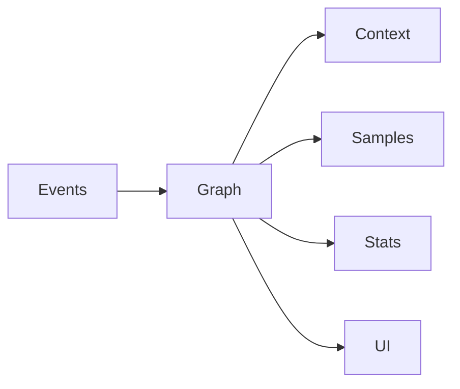

# 0012: Run log format

- **Status:** Proposed, 2026-11-12. Not yet accepted.
- **Layer:** observability, state and recovery
- **Builds on:** [0005](0005-task-format.md), [0006](0006-tool-set.md), [0007](0007-fold-and-unfold.md), [0011](0011-build-from-scratch-in-jac.md)

## Principles

1. **One append-only file per run is the source of truth.** One JSON object per line. Nothing is rewritten.
2. **Store what happened, not what we concluded.** Raw model output, raw tool results, statuses. Folded views, loss masks and statistics are computed from the log, so they can be recomputed when a rule changes.
3. **Every line says where it belongs.** Run, session, phase, feature, task, step. Without this the per-step and per-task measurements of 0005 cannot be made.

## 1. From log to views



| View | Built how | Used for |
|---|---|---|
| Graph | Replay the events into nodes (Project, Feature, Task, Step, Turn) | Everything below; rebuilt after a crash |
| Context | Walker applying the fold rules of 0007 | The next model request |
| Samples | The same walker, plus the loss rules of section 4 | Training |
| Stats | Walker summing tokens, time and outcomes per step, task, feature | Finding the size limits of 0005 and *K* of 0007 |
| UI | Read by the CLI and web front ends | Showing a run |

Context and Samples come from the same renderer, so the model is trained on exactly what it sees at run time.

## 2. Files of one run

| File | Content |
|---|---|
| `runs/<run>/meta.json` | Harness commit, Jac version, model file and its hash, chat template hash, sampling settings, seed, fold rule version, mode (interactive or auto) |
| `runs/<run>/events.jsonl` | The log |
| `runs/<run>/project/` | The app being built. Every file change is also in the log, so any earlier state can be rebuilt. |

## 3. Events

Fields on every line:

| Field | Meaning |
|---|---|
| `v` | Format version |
| `seq`, `ts` | Order and time |
| `type` | Event type (table below) |
| `actor` | `model`, `admin`, `harness` or `user` |
| `session` | One context (one walker). A new session starts at each task and at each Fresh restart. |
| `phase`, `feature`, `task`, `step` | Position in the work tree; empty where not applicable |

Event types:

| Type | Written when | Own fields |
|---|---|---|
| `run` | Start and end of a run | Start: the user's requirement. End: outcome. |
| `phase` | A phase is entered or left | Gate items and their results |
| `task`, `step` | Created, or status changes | The card (on creation); old and new status; the check results that caused the change |
| `request` | A prompt is sent to a model | `shown`: the ids in the prompt and the level of each (full, line, block, card); prompt tokens; hash of the rendered text |
| `reply` | The model answers | `id`; raw text exactly as generated, reasoning included; parsed call or the parse error; output tokens; seconds; finish reason |
| `tool` | A tool call finishes | `id`; tool; arguments; status (`ok`, `failed`, `refused`); the record of 0007 (code, message); full result text; seconds |
| `file` | A file changes | Path; full new content; who changed it |
| `stall` | A stall rule fires, or the model calls `stuck` | Which rule; the evidence (ids) |
| `escalate` | The ladder moves | Tier (fresh, advise, takeover); for advise, the hint text |
| `user` | The user types or answers `ask` | Text |

- Ids (`m12`, `s3`, `T03`) are unique within a run. They are the ids the model sees and passes to `unfold`.
- The rendered prompt is not stored in full. It is rebuilt from `shown` and checked against the hash. A failed check means the renderer changed.
- Admin turns use the same `request`, `reply` and `tool` events with `actor: admin`.

Example:

```
{"v":1,"seq":41,"type":"reply","actor":"model","session":"S7","phase":"implement","feature":"F1","task":"T03","step":"server","id":"m12","raw":"<think>...</think><tool_call>...","call":{"tool":"edit","args":{...}},"out_tokens":212,"sec":2.1,"finish":"stop"}
{"v":1,"seq":42,"type":"tool","actor":"harness","session":"S7","phase":"implement","feature":"F1","task":"T03","step":"server","id":"m12","tool":"edit","status":"failed","code":"E1053","message":"Cannot assign str to int","result":"...","sec":0.9}
```

## 4. Training samples

**One sample per model turn**: the context exactly as rendered for that turn, and the reply as the target.

Reason: with folding, the context at turn 10 is not the context at turn 9 plus one message. Earlier turns have changed level. A whole session cannot be stored as one conversation and still match what the model saw.

Which turns become targets is decided at export, from the log:

| Turn | Target? |
|---|---|
| Reply whose tool call ended `ok` | Yes |
| Reply whose call ended `failed` or `refused` | No. It still appears, folded, in the context of later samples. |
| `stuck` call | No |
| Admin fix, replayed as small-model tool calls | Yes, in the context the small model had reached |
| Turns after an Advise hint | Exported with the hint removed from the context |

- The rules are applied by the exporter, not written into the log. Changing a rule means exporting again, not running again.
- Whole-run filters (only runs that passed E2E, and so on) belong to the dataset step, not to this format.

## 5. Open points

1. **Cost of one sample per turn.** A session of *n* turns gives *n* samples whose contexts overlap heavily. Only the reply carries loss. The training side should confirm this is affordable, or we need a fold design where each context is an exact prefix of the next.
2. **Failed turns as targets.** This draft never trains on them. A reply that failed only because of a later check (correct edit, unrelated error elsewhere) may still be a good target. Decide after looking at real runs.
3. **Full prompt text.** Rebuilt from `shown` in this draft. Storing it in full is simpler to audit and much larger.
