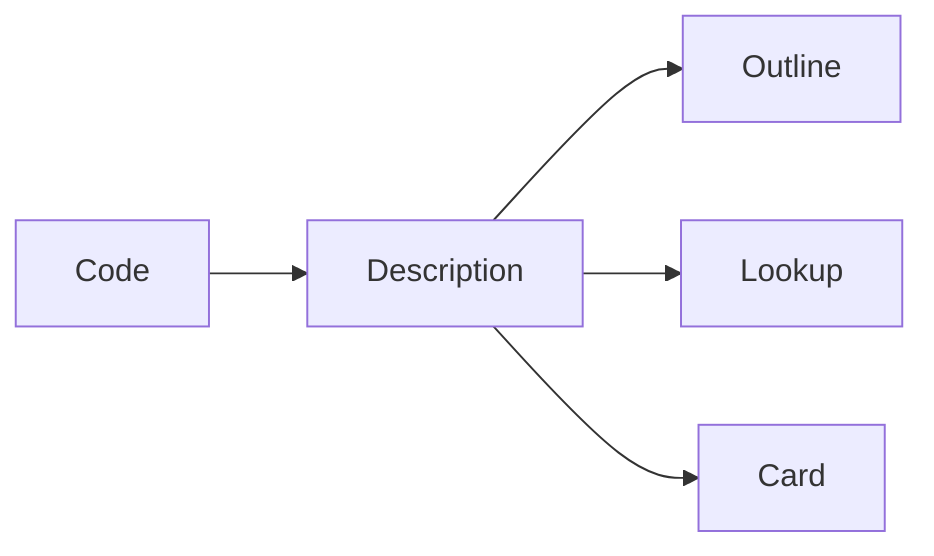

# 0016: Code conventions enforced by the harness

- **Status:** Proposed, 2026-11-13
- **Layer:** gates, context assembly
- **Builds on:** [0004](0004-sdlc-phases-and-gates.md), [0006](0006-tool-set.md) (`lookup`, `map`), [level 2 runs](../research/level2-runs-2026-11-13.md)

## Principle

A convention exists only if a gate checks it. The harness keeps few conventions, each one because another part of the harness reads the result.

## 1. Descriptions

Every server entry point that others call (`def:pub`, `walker:pub`) has a description: the string placed directly above it.

Not required: client components and the functions inside them, declarations without `:pub`, abilities inside a walker, file headers. Data declarations (`node`, `edge`, `obj`) are not checked for now.

| Rule | Example |
|---|---|
| Says what the thing does or holds, as seen by its user. Like the description of an abstract data type. | `"""Store a new task and return it."""` |
| No implementation detail | Not: "Appends to root with ++> and returns the node" |
| No list of inputs and outputs. The signature already has the names and types. | Not: "Args: title (str). Returns: Task" |
| One or two sentences | |

Why: the outline, `lookup` and the task card show the signature and this description instead of the code. With names only, the model skipped the server file in 5 of 6 runs; with descriptions, in 0 of 6.

## 2. What the gate checks

| Check | How | At |
|---|---|---|
| A description is present on every `def:pub` and `walker:pub` that is not a client component | Script | `submit` |
| It has no `Args:`, `Returns:`, `Parameters:` section | Script | `submit` |
| It is not just the name repeated | Script | `submit` |
| It is true and says what the thing does | Not checkable by script. Admin review in the Deliver phase, if at all. | |

The same gate applies to the admin's code.

## 3. How the model learns the convention

| Channel | Content |
|---|---|
| Template | Every declaration in it already follows the rule |
| Gate message | Names the declaration and shows the form to write |
| Training trajectories | All generated under this gate |

No rule text is added to the system prompt unless measurement shows the three above are not enough.

## 4. Other conventions

Already enforced: Jac import form (compiler), entry-file imports (wiring check), read before change.

Candidates, not decided: nodes and walkers instead of Python-style globals for stored data; shadcn components and layout rules. Each needs a check before it becomes a convention.

## 5. Harness text is short

Every word shown to the model costs context and attention. Tool descriptions, results, refusals and the system prompt say only what the model needs for its next call: which file, which line, what to write.

## Decided in discussion (2026-11-13)

- Descriptions are for the server side, on what is called from outside. Nothing is required on the client side.
- Harness text is kept as short as possible.

## Open

1. Should `node`, `edge` and `obj` need a description? Not checked now.
